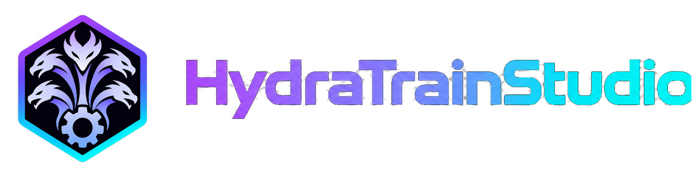
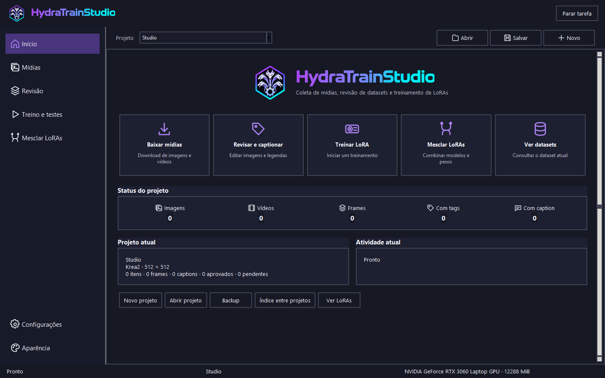

  
  
Da primeira imagem à comparação dos checkpoints de um LoRA, em um aplicativo local.

  
<a href="https://github.com/GabrielRLemes/HydraTrainStudio/releases"><b>Baixar para Windows ou Linux</b></a> · <a href="#primeiro-projeto">Primeiro projeto</a> · <a href="#próximas-versões">Próximas versões</a>

## Instalação

| Plataforma | Primeiro acesso | Próximas aberturas |
|---|---|---|
| Windows x64 | Na release, baixe e execute **HydraTrainStudio-Windows.exe**. | Use o menu Iniciar ou abra **HydraTrainStudio.exe** em `%LOCALAPPDATA%\HydraTrainStudio`. |
| Linux x86-64 · experimental | Baixe **HydraTrainStudio-Linux.sh** e execute `bash HydraTrainStudio-Linux.sh` na pasta do download. | Use o menu de aplicativos ou execute `bash "${XDG_DATA_HOME:-$HOME/.local/share}/HydraTrainStudio/abrir-linux.sh"`. |

O launcher baixa o pacote da versão, verifica o SHA-256, instala o código da interface e dos motores de integração e abre o aplicativo. Na primeira abertura, o assistente oferece os componentes locais. Marque as famílias desejadas, **Caption** para visão local e **ComfyUI** para gerar testes. Você pode voltar ao assistente por **Configurações → Componentes**.

O treino local usa **NVIDIA com CUDA**. A instalação original usou uma RTX 3060 de 12 GB e 32 GB de RAM. O preset deve ser calibrado no computador de destino. Confira o espaço mostrado pelo assistente antes de baixar os pesos. Downloads por URL personalizada acrescentam espaço ao total exibido.

**Linux:** use uma sessão gráfica, driver NVIDIA compatível com a pilha CUDA 13 e Python 3.11 ou superior com Tk e venv. São necessários curl e unzip. Para compilar llama.cpp, instale CMake, um compilador C++ e, para aceleração CUDA, nvcc. Um `llama-server` já disponível no PATH também pode ser usado. O salvamento de chaves usa o chaveiro Secret Service do desktop. A validação em Linux com GPU física está no roteiro da versão.

## Primeiro projeto

1. Em **Configurações**, escolha a família, calibre a resolução e configure o serviço de visão.
2. Em **Mídias**, importe arquivos, consulte os sites habilitados ou extraia frames de vídeo.
3. Em **Revisão**, confira as miniaturas, ajuste o recorte e edite tags e captions. Você pode refazer a seleção ou o projeto inteiro. A aprovação prepara as imagens e as legendas para o treino.
4. Em **Treino e testes**, escolha **Automático** ou ajuste épocas, rank, alpha, lote, acumulação, otimizador e agenda no **Avançado**.
5. Compare checkpoints com os mesmos prompts e sementes. Marque favoritos, reteste com outra semente ou retome uma grade incompleta.

## Modelos

| Uso | Como escolher |
|---|---|
| **Treinamento** | Krea2 usa a base Raw, Anima usa Anima Base e Illustrious usa Illustrious XL v0.1. O perfil fixa os arquivos de treino e o assistente verifica os pesos de distribuição pelo hash do manifesto. |
| **Visão e captions** | Instale o conjunto GGUF padrão, escolha um GGUF visual e seu projetor local ou forneça as duas URLs diretas do Hugging Face. A configuração também oferece servidores de visão já instalados. |
| **Teste do LoRA** | Use a base padrão da família ou selecione um arquivo compatível em **Testar e comparar → Escolher base de teste**. O assistente pode baixar esse arquivo por URL. A comparação registra a escolha e a reutiliza nas retomadas e nos retestes. |

## Outras ferramentas

- **Dataset** · Importação de projetos, banco, manifesto e arquivos com TXT adjacente. A grade permite seleção múltipla, aprovação e edição em lote.
- **Captions** · Prompts personalizados, geração e melhoria de descrições a partir da imagem, das tags e do texto editado.
- **Mesclagem** · Combine dois ou mais LoRAs compatíveis, ajuste os pesos individualmente e grave um novo arquivo.
- **Interface** · Tema claro ou escuro, tamanho da fonte e seleção de português, inglês, espanhol ou chinês simplificado. A cobertura de tradução ainda é parcial.

## Próximas versões

| Prioridade | Entrega planejada |
|---|---|
| Instalação | Validar do zero em máquinas Windows e Linux com GPU e publicar a matriz de driver, VRAM e famílias exercitadas. |
| Escolha de modelos | Catálogo de bases de teste com arquitetura e requisitos visíveis antes do download. |
| Comparação | Visualização ampliada lado a lado entre checkpoints e navegação entre sementes. |
| Idiomas | Completar mensagens de execução e diálogos nos quatro idiomas. |

Encontrou um problema? Informe o sistema, a GPU, a família de modelo e a etapa em que ocorreu. Remova chaves de API e caminhos pessoais antes de anexar logs. [Abrir uma issue](https://github.com/GabrielRLemes/HydraTrainStudio/issues)

O código original usa a [licença MIT](LICENSE). Os modelos e motores são baixados de seus respectivos projetos. [Componentes e créditos](THIRD_PARTY.md) · [Construir uma release](docs/PUBLICAR.md)
